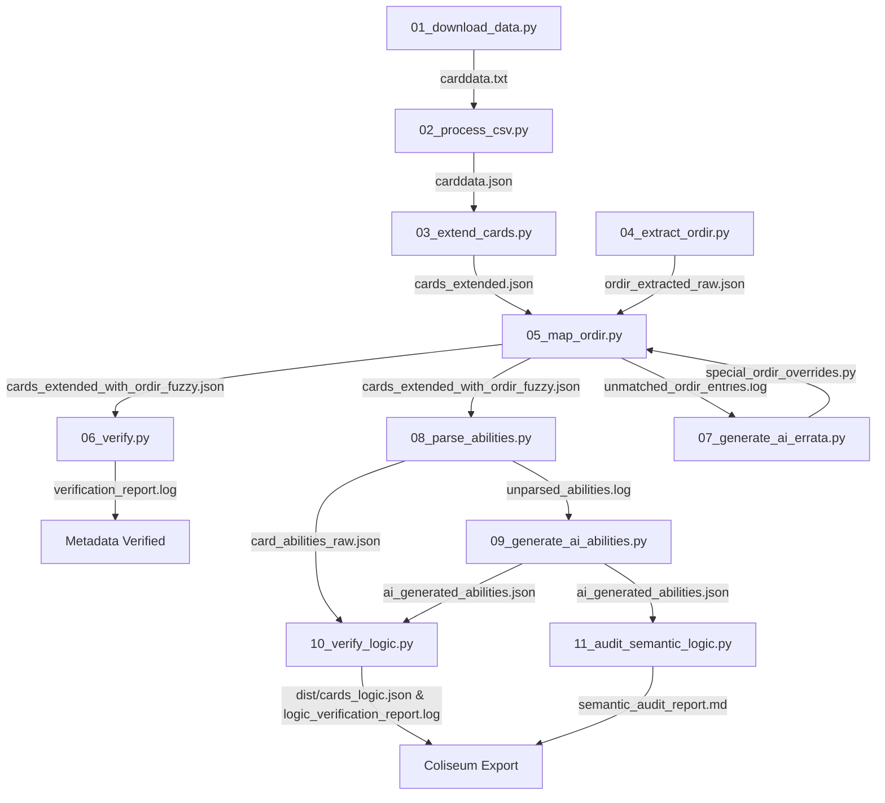

# Redemption TCG Card Data Pipeline

This repository contains the end-to-end data processing and ability AST pipeline for Redemption TCG (aligned with **ORDIR 7.1.0** and **REG v11.1.0**). The pipeline downloads raw card data, cleans and partitions dual/multi-type card metadata, maps ORDIR categories, verifies card metadata consistency, and compiles structured game-engine ASTs into `data/dist/` for Redemption Coliseum.

> [!IMPORTANT]
> **External Documents & Repository Contents**
> Official rulebooks (`ORDIR_PDF_7.1.0.txt`, `REG_PDF_11.1.0.txt`) are stored locally under `data/` (git-ignored) and configured dynamically via `config.json`.

---

## Configuration (`config.json`)

All input/output paths and rulebook filenames are loaded dynamically from **`config.json`** in the project root:

```json
{
    "ordir_file": "data/ORDIR_PDF_7.1.0.txt",
    "cards_file": "data/cards_extended.json",
    "carddata_url": "https://raw.githubusercontent.com/jalstad/RedemptionLackeyCCG/master/RedemptionQuick/sets/carddata.txt",
    "carddata_txt": "data/carddata.txt",
    "carddata_json": "data/carddata.json",
    "ordir_extracted_raw": "data/ordir_extracted_raw.json",
    "cards_extended_with_ordir_fuzzy": "data/cards_extended_with_ordir_fuzzy.json",
    "unmatched_ordir_entries_log": "data/unmatched_ordir_entries.log",
    "verification_report_log": "data/verification_report.log",
    "card_abilities_raw": "data/card_abilities_raw.json",
    "cards_logic_json": "data/dist/cards_logic.json",
    "card_hierarchy_json": "data/dist/cardHierarchy.json",
    "unparsed_abilities_log": "data/unparsed_abilities.log",
    "logic_verification_report": "data/logic_verification_report.log"
}
```

---

## Pipeline Architecture

Stages 01–06 form the core metadata & ORDIR pipeline (`run_pipeline.py`), Stage 07 resolves unmatched ORDIR errata, and Stages 08–11 compile, verify, audit, and export REG v11.1.0 card ability ASTs.



### Metadata & ORDIR Stages (01–07)
*   **Stage 1 — `scripts/01_download_data.py`:** Fetches latest `carddata.txt` from LackeyCCG.
*   **Stage 2 — `scripts/02_process_csv.py`:** Cleans TSV rows, standardizes characters, and determines testaments (`OT`, `NT`, `UNKNOWN`).
*   **Stage 3 — `scripts/03_extend_cards.py`:** Expands `CardSides` (`top`, `bottom`, `shared`), brigade attributes, gender, generic status, human flags, and canonical classes.
*   **Stage 4 — `scripts/04_extract_ordir.py`:** Extracts ORDIR 7.1.0 categories and card lists.
*   **Stage 5 — `scripts/05_map_ordir.py`:** Matches extracted ORDIR entries to canonical cards using `mappings/alias_engine.py` and `mappings/special_ordir_overrides.py`.
*   **Stage 6 — `scripts/06_verify.py`:** Runs deterministic metadata sanity checks across alignments, multi-type/dual card types, Star flags, Nativity scope, and Bible references (`data/verification_report.log`).
*   **Stage 7 — `scripts/07_generate_ai_errata.py`:** Optional AI errata resolver updating `mappings/special_ordir_overrides.py`.

### Ability AST Stages (08–11)
*   **Stage 8 — `scripts/08_parse_abilities.py`:** Deterministic REG v11.1.0 parser with partial-side retention, Star ability separation (`side="star"` in unparsed logs), conditional protection rules, and abbreviation masking (`data/card_abilities_raw.json`, `data/unparsed_abilities.log`).
*   **Stage 9 — `scripts/09_generate_ai_abilities.py`:** LLM extractor for unparsed sides and Star clauses (`data/ai_generated_abilities.json`), preserving clean card IDs and per-side deduplication.
*   **Stage 10 — `scripts/10_verify_logic.py`:** Merges deterministic + AI ASTs (preserving `is_star=True` and regular abilities per side), validates Pydantic schemas & `fact_matrix.py` invariants, links `card_titles` via `CardLinker`, audits extended DB coverage (`data/logic_verification_report.log`), and exports `data/dist/cards_logic.json`, `ast_constants.json`, and `cardHierarchy.json`.
*   **Stage 11 — `scripts/11_audit_semantic_logic.py`:** Offline hybrid semantic similarity (`all-MiniLM-L6-v2` cached locally) and round-trip decompiler (`ability_decompiler.py`) audit writing `data/semantic_audit_report.md`.

---

## Setup and Installation

### Prerequisites
*   Python 3.12+
*   Active Python virtual environment (`.venv`)

### Installation Steps

1.  **Create and Activate Virtual Environment:**
    ```powershell
    # Windows PowerShell
    python -m venv .venv
    .venv\Scripts\Activate.ps1
    ```

2.  **Install Required Packages:**
    ```powershell
    pip install -r requirements.txt
    ```

3.  **Configure API Keys (Optional for AI Corrector):**
    Copy `.env.template` to `.env` and fill in your Groq or Gemini credentials, or start a local Ollama service.

---

## Running the Pipeline

You can execute Stages 01–06 deterministically with:

```powershell
.venv\Scripts\python.exe run_pipeline.py
```

And execute Ability AST parsing, verification, semantic audit, and Coliseum `dist/` export with:

```powershell
.venv\Scripts\python.exe scripts/08_parse_abilities.py
.venv\Scripts\python.exe scripts/10_verify_logic.py --export-dist
.venv\Scripts\python.exe scripts/11_audit_semantic_logic.py
.venv\Scripts\python.exe -m unittest discover -s tests -v
```

If there are still unmatched ORDIR errata or unparsed card abilities to resolve via LLM:

```powershell
.venv\Scripts\python.exe scripts/07_generate_ai_errata.py
.venv\Scripts\python.exe scripts/09_generate_ai_abilities.py
```

---

## Outputs & Reports

*   **Final extended DB:** `data/cards_extended_with_ordir_fuzzy.json` (Contains extended cards with ORDIR 7.1.0 categories and card side metadata).
*   **Coliseum AST Bundle:** `data/dist/cards_logic.json`, `data/dist/ast_constants.json`, `data/dist/cardHierarchy.json` (Compiled production AST bundle).
*   **Verification Logs:** `data/verification_report.log` (ORDIR QA), `data/logic_verification_report.log` (Stage 10 AST & coverage audit), `data/unparsed_abilities.log` (Stage 8 unparsed clauses), `data/semantic_audit_report.md` (Stage 11 embedding & fact-matrix report).
